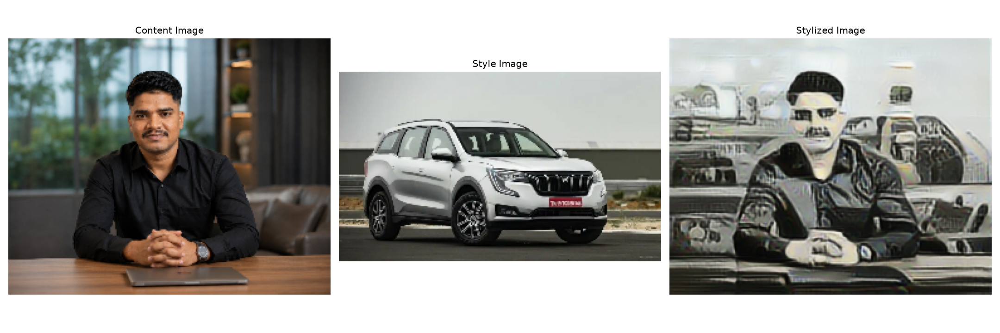

# Neural Style Transfer

**Author:** [Ajim Mujawar]
**Track:** Generative AI - Task 05

Apply the artistic **style** of one image (e.g. a famous painting) to the **content** of another image using the neural style transfer algorithm of Gatys et al. (2015), implemented with TensorFlow/Keras and a pre-trained **VGG19**.

## Table of Contents
- [Overview](#overview)
- [How It Works](#how-it-works)
- [Project Structure](#project-structure)
- [Installation](#installation)
- [Usage](#usage)
- [How to Test](#how-to-test)
- [Hyper-parameters](#hyper-parameters)
- [Results](#results)
- [References](#references)

## Overview
Given a **content image** (a photo) and a **style image** (a painting), the program creates a new image that keeps the content of the photo but looks painted in the style of the artwork. The project includes:
1. The original **optimisation-based** algorithm (Gatys et al.) with total variation regularisation.
2. An optional **fast** version using the pre-trained TF-Hub arbitrary-stylization model for comparison.
3. A notebook with experiments (style weight, with/without TV loss, optimisation vs. fast model).

## How It Works
| Step | Description |
|---|---|
| Feature extractor | VGG19 (ImageNet), frozen, intermediate layers only |
| Content | Feature map of `block5_conv2` |
| Style | Gram matrices of `block1_conv1` ... `block5_conv1` |
| Loss | `style_weight x L_style + content_weight x L_content + tv_weight x L_tv` |
| Optimisation | The image pixels are a `tf.Variable` (initialised from the content image) updated with Adam; pixels clipped to [0, 1] |

Full explanation: [`docs/theory.md`](docs/theory.md).

## Project Structure
```
neural-style-transfer/
├── notebooks/
│   └── neural_style_transfer.ipynb   # Complete walkthrough + experiments (Colab GPU)
├── src/
│   ├── config.py                     # Layers, weights, default image URLs
│   ├── image_utils.py                # Load/save images, comparison and loss plots
│   ├── model.py                      # VGG19 extractor, Gram matrix, StyleContentModel
│   ├── style_transfer.py             # Optimisation loop (Gatys et al.)
│   ├── fast_style_transfer.py        # Optional TF-Hub fast model
│   ├── stylize.py                    # Command-line entry point
│   └── smoke_test.py                 # Offline test (no downloads)
├── images/                           # Put your own content/style images here
├── docs/
│   └── theory.md                     # Theory notes
├── outputs/                          # Generated images (git-ignored)
├── requirements.txt
├── .gitignore
└── README.md
```

## Installation
A GPU is recommended (free Google Colab T4 works). A CPU works for small images but is slow.

```bash
cd neural-style-transfer
python -m venv venv
venv\Scripts\activate             # Mac/Linux: source venv/bin/activate
pip install -r requirements.txt
```
VGG19 weights (about 80 MB) are downloaded automatically on first run.

## Usage
**Option A - Notebook (recommended):** upload `notebooks/neural_style_transfer.ipynb` to Google Colab, select a **T4 GPU** runtime and run all cells.

**Option B - Command line** (run from the project root):
```bash
# Sample images (Labrador + Kandinsky), 1000 steps
python -m src.stylize

# Your own images
python -m src.stylize --content images/photo.jpg --style images/starry_night.jpg --steps 1000

# Stronger style / smoother output
python -m src.stylize --style-weight 0.1 --tv-weight 50

# Fast version with the pre-trained TF-Hub model (seconds)
python -m src.stylize --fast
```
Outputs: `outputs/stylized.png`, `outputs/comparison.png` (content | style | result) and `outputs/loss_curves.png`.

| Argument | Default | Description |
|---|---|---|
| `--content`, `--style` | sample images | Paths to your images |
| `--steps` | 1000 | Optimisation steps |
| `--max-dim` | 512 | Longest image side in pixels |
| `--style-weight` | 0.01 | Strength of the style |
| `--content-weight` | 10000 | Strength of content preservation |
| `--tv-weight` | 30 | Smoothness (total variation) |
| `--lr` | 0.02 | Adam learning rate |
| `--fast` | off | Use TF-Hub fast model |

## How to Test
1. **Smoke test (offline, no downloads, about 1 minute):**
   ```bash
   python -m src.smoke_test
   ```
   It uses random VGG weights on synthetic images to check the Gram matrix, the feature extractor and the optimisation loop, and ends with `ALL CHECKS PASSED`. (Its image is not a real style transfer.)
2. **Quick real run:**
   ```bash
   python -m src.stylize --steps 100 --max-dim 256
   ```
   Open `outputs/comparison.png`. The result should already show the painting's colours and strokes over the dog.
3. **Full run:** 1000 steps at 512 px, then compare `outputs/stylized.png` with the original content image.

## Hyper-parameters
| Change | Effect |
|---|---|
| Higher `style_weight` | More painterly, content gets distorted |
| Higher `content_weight` | Output stays closer to the photo |
| Higher `tv_weight` | Smoother, less noise (too high = blurry) |
| More `steps` | Stronger, cleaner result with diminishing returns |
| Larger `max_dim` | More detail but slower and more memory |

## Results
After running, find your outputs in `outputs/`. Add your best ones here:
```markdown

```

## References
- Gatys, Ecker, Bethge. *A Neural Algorithm of Artistic Style* (2015) - https://arxiv.org/abs/1508.06576
- TensorFlow tutorial - https://www.tensorflow.org/tutorials/generative/style_transfer
- Fast arbitrary stylization model - https://tfhub.dev/google/magenta/arbitrary-image-stylization-v1-256/2
- Johnson et al. *Perceptual Losses for Real-Time Style Transfer* (2016)

## Author
**[Ajim Mujawar]**
